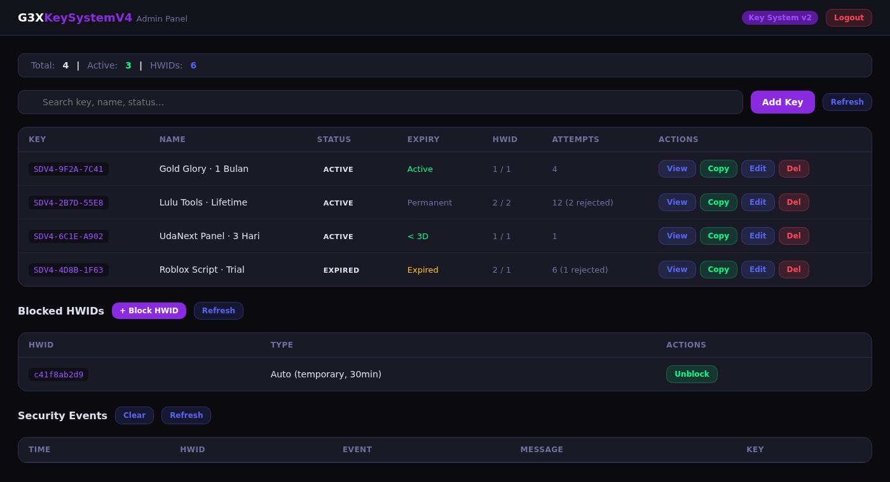

# StarDev Licence V4

Self-hosted licensing system for **Roblox scripts, mod APKs, standalone APKs,
web apps, bots, and desktop tools**.



## Why

Most key systems are hosted services with recurring fees. This one is source
code you deploy once on your own Vercel project and own: your Redis, your keys,
your brand, your data. One buyer = one isolated stack, so rate limits never
collide with other sellers.

## What is in the stack

| Part | What it does |
|---|---|
| `api/verify` | Validates key + HWID, expiry, device limits |
| `api/admin` | Create / edit / delete keys |
| `api/hwid` | Block and unblock hardware IDs |
| `api/security` | Tamper / abuse reports |
| Web admin panel | Totals, search, key editor, HWID blocking, security events |
| Android admin app | Manage keys from a phone |
| Telegram bot | Buyer-facing redeem and key check |
| Discord bot | Admin slash commands: `/addkey /listkeys /editkey /delkey /blockhwid /unblockhwid` |
| Storefront | Catalog, product pages, guide, contact — driven by one `data.js` |

## Protocol modes

- `raw` — plain JSON over HTTPS
- `aes` — AES-256-CBC payload, 300s anti-replay window
- `aes_sign` — AES + HMAC + Ed25519 signed responses

Clients for Roblox (Luau), Android (Java), and any HTTP-capable platform.

## Typical client check

```lua
local result = VerifyClient.verify(userKey, VerifyClient.getHwid())
if result and result.valid then
  -- licensed
else
  warn(result and result.message or "server unreachable")
end
```

```http
POST https://your-project.vercel.app/api/verify
Content-Type: application/json

{"key":"SDV4-XXXX-XXXX","hwid":"device-id"}
```

## Requirements

- Vercel project
- Upstash Redis database
- Ed25519 key pair for signing
- Optional: Telegram bot token, Discord application

## Get the source

This repository is a product overview and demo. The source code itself is sold
as a one-brand license.

- Store (ID): https://stardev-community.github.io/stardev-docs/shop/
- Store (EN): https://stardev-community.github.io/stardev-docs/shop/en/
- Telegram: [@yt_lulu](https://t.me/yt_lulu)

Pricing: $6.50 (1 month updates) / $12.50 (lifetime). QRIS available for
Indonesian buyers.

## License terms

One brand/stack per purchase. Modify freely for your own product. Do not resell
or redistribute the source.
